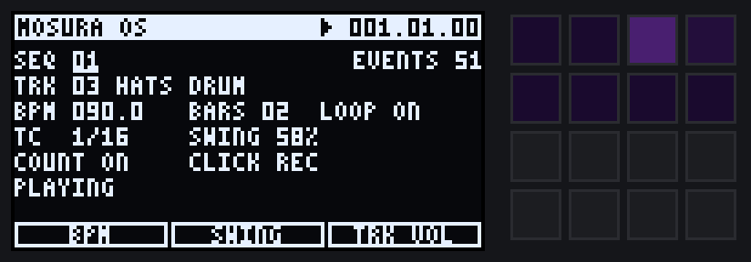

# doomfx + MOSURA OS

SP-1200, MPC60 and MPC3000 flavoured effects, a Juno-106 synth, MPC groove
tools and **MOSURA OS**, an MPC 2000XL / 2500 style operating system for the
Roland SP-404MK2. Built to extend the idea behind
[DOOM OS](https://github.com/klangfeld-labs/doom-os).

DOOM OS is distributed as a binary patch for Roland's 5.52 firmware and
doesn't have an SDK yet (it's on its "coming next" list). So this project is
portable C: no memory allocation, any block size, ready to port once there
is a way to load code. You can use it now from desktop tools: `doomfx`
renders effects onto WAV files you can load onto the SP, and `mosura` runs
the whole OS from scripts of button presses.

## MOSURA OS



The SP-404MK2's weak spot is menu diving and button combos, and DOOM OS adds
features on top of that. MOSURA OS rebuilds the SP around the MPC workflow
instead:

* **One button, one screen:** MAIN, STEP, TRACK, FX, MIX and SONG. Press the
  button again for that screen's next page. No combos for everyday work.
* **Every screen has the same layout:** a header with the transport, fields
  you turn to and push to edit, and a knob row that always says what
  CTRL 1-3 do.
* **MPC sequencing:** 32 sequences, 16 tracks, 96 PPQN, timing correct
  with swing, REC / OVERDUB, count-in, note repeat on the swung grid,
  erase, undo / redo, a step editor, song mode, next-sequence queueing and
  tap tempo. Tracks are drum (sample pads, banks A-J) or synth (the
  Juno-106, chromatic).
* **Effects belong to tracks and buses,** MPC 2500 style: an insert per
  track, two send buses and two master slots, all on one FX screen. Every
  effect in this library fits any slot, including four new ones: Tape Warp,
  Dust, Stutter and Dub Echo.
* **Easy to restyle:** name, boot screen, track names and pad LED colours are
  all in `src/os/theme.h`.

```sh
make
./build/mosura run examples/first-beat.mos --out beat.wav   # a whole beat made with button presses
```

The full guide, with every screen, the effect routing and the suggested
button mapping, is in [docs/MOSURA.md](docs/MOSURA.md).

## Effects

| Effect | CTRL 1 / 2 / 3 | SHIFT | What it is |
|---|---|---|---|
| `sp1200` | Pitch, Filter, Drive | Output (1-2, 3-6, 7-8), Reso, Bits, Mix, Level | 26.04 kHz / 12-bit sampling with no anti-alias filter, the pitch-down trick, and the three output types (sweepable SSM2044-style 4-pole, fixed filter, unfiltered) |
| `mpc60` | Drive, Punch, Mix | Bits, Comp, Rate, Level | 40 kHz / 12-bit non-linear (companded) converters with proper filtering, plus a punchy output stage |
| `mpc3000` | Filter, Reso, Warmth | Drive, Bits, Mix, Level | 2-pole resonant pad filter and a warm output stage (low shelf, soft top, even-harmonic saturation) |
| `bitladder` (new) | Cutoff, Reso, Crush | Env, Drive, Mix, Level | A ladder filter clocked *inside* a crushed converter, so resonance and sweeps alias and step; an envelope follower turns it into a dirty auto-wah |
| `busglue` (new) | Squash, Dirt, Mix | Attack, Release, SC HPF, Level | One-knob drum bus compressor with a sidechain highpass, plus a parallel 26.04 kHz / 12-bit crunch layer |
| `junochorus` | Mode (I, II, I+II), Depth, Mix | Hiss, Level | The Juno-60 / 106 BBD chorus on its own, for anything on the SP |
| `tapewarp` (new) | Wow, Flutter, Sat | Age, Bump, Hiss, Mix, Level | Worn tape: wow with a random drift so it never loops, flutter, saturation, 90 Hz head bump, HF loss and hiss |
| `dust` (new) | Crackle, Wear, Noise | Rumble, Mono, Mix, Level | Worn record: crackle and rare pops, groove wear, surface noise, platter rumble, mono lows |
| `stutter` (new) | Rate, Gate, Mode (Off, Gate, Repeat) | Swing, Decay, Fall, Mix, Level | Tempo-locked chop on an MPC-swung grid, or a repeat of one slice that falls in pitch and fades |
| `dubecho` (new) | Time, Feedback, Mix | Tone, Drive, Wobble, Spread, Level | Tempo-synced tape echo: time changes glide (siren sweeps), feedback past 100% runs away but stays bounded |

`stutter` and `dubecho` follow tempo through the optional `set_tempo` hook
in `doomfx.h`. MOSURA OS calls it with the sequence's tempo and position.
`doomfx render` runs them at 120 BPM.

The pitch trick: sampling a record a few semitones fast and tuning it back down
on the SP-1200 keeps the pitch but lowers the effective sample rate to
26.04 kHz × 2^(−semitones/12). `sp1200 pitch=5` is roughly a 33 rpm record
sampled at 45 rpm, and the output 1-2 filter follows the pitch down, as the
dynamic filters on outputs 1-2 of the hardware do.

These are character models, not circuit simulations. Converter rates, bit
depths and the general signal flow follow the original machines. The filter
voicings and output stages are approximations: comments in each file under
`src/fx/` say which is which.

## Juno-106 synth

`juno106` is a six-voice polysynth modelled on the Roland Juno-106, played
with note on / note off (`include/doomfx_synth.h`). On the SP that maps to the
pads in chromatic mode or the DOOM OS piano roll.

* **DCO:** saw, pulse with PWM (LFO or manual), square sub one octave down,
  noise, and Range 16' / 8' / 4'. Band-limited, and stable like the real
  DCOs.
* **VCF:** 24 dB/oct resonant lowpass that self-oscillates, with envelope
  (+/−), LFO and keyboard follow.
* **HPF:** four positions; 0 is the bass boost, 1 is flat.
* **VCA:** envelope or gate mode. One ADSR per voice drives both the VCF
  and the VCA, as on the 106.
* **LFO:** triangle with a delayed fade-in on each new note.
* **Chorus:** Off, I, II or I+II.
* **Velo** (off by default) adds velocity sensitivity, which the 106 didn't
  have but the SP's pads can use.
* **Controls:** CTRL 1 / 2 / 3 are Cutoff, Reso and Env amount, with the
  other 22 controls on further pages.
* **Presets:** `pad`, `bass`, `brass`, `strings`, `pluck` and `keys`. These
  are starting points in the Juno style, not copies of Roland's factory
  patches.

The envelope ranges follow the 106's published specs. The HPF corners, the
filter voicing and the chorus timings (commonly cited measurements) are
approximations.

## Groove engine

`include/doomfx_groove.h` does MPC-style swing, timing correct (quantise with
strength and window), humanise and PPQN conversion on note events.

* MPC60 / MPC3000: 96 PPQN, sixteenth swing from 50 to 75%. At 66% the off
  sixteenth moves from tick 24 to tick 32.
* SP-1200: 24 PPQN, eighth-note swing. Its settings (50, 54, 58, 63, 67, 71%)
  are exactly one tick apart: the off eighth lands on tick 12, 13, ... 17.
  For sixteenth swing, program at double tempo, as on the real machine.
* Humanise is seeded, so the same seed gives the same result (an undo can
  replay it).

## Build and use

Needs a C99 compiler and `make`.

```sh
make            # builds build/doomfx, build/mosura and the tests
make test       # runs both test suites

./build/doomfx list                                   # effects and their parameters
./build/doomfx demo beat.wav --swing 62 --bpm 90      # a synthesised two-bar beat with MPC swing
./build/doomfx demo sp.wav --machine sp1200 --swing 63
./build/doomfx groove --swing 66                      # swing table: ticks and milliseconds
./build/doomfx render sp1200 beat.wav out.wav pitch=5 cutoff=7000 drive=6
./build/doomfx render sp1200 beat.wav out.wav output=7-8 pitch=12 --bits 16
./build/doomfx render busglue loop.wav out.wav squash=70 dirt=50

./build/doomfx synth juno106 chords.wav --preset pad   # plays a Dm7 G7 Cmaj7 Am7 progression
./build/doomfx synth juno106 bass.wav --preset bass    # plays a bassline
./build/doomfx synth juno106 lead.wav --seq "A3:0.5 C4:0.5 E4:1 -:1 G4+B4:2" --bpm 96 cutoff=1200 reso=60 chorus=I+II
```

`--seq` is a list of steps separated by spaces: notes joined with `+`, `-` for
a rest, and an optional `:beats` length (C4 = MIDI 60). Every note is held for
`--gate` (default 0.9) of its step.

`render` takes parameters in their own units (Hz, dB, semitones, %) or labels
(`output=7-8`), reads 8/16/24/32-bit PCM or 32-bit float WAV, and writes 24-bit
(or `--bits 16`) stereo WAV that the SP-404MK2 imports.

## Layout

```
include/doomfx.h          effect API (host-owned state, CTRL 1-3 + SHIFT params, knob mapping)
include/doomfx_groove.h   swing / quantise / humanise
include/doomfx_synth.h    synth API: note on / off, render, presets
include/mos.h             MOSURA OS API: keys, pads, VALUE, CTRL knobs in; audio, screen, LEDs out
src/dsp.h                 shared blocks: converter model, ZDF ladder, SVF, biquads, smoothers
src/fx/*.c                the effects
src/synth/juno106.c       the Juno-106 engine
src/juno_chorus.h         BBD chorus shared by the synth and the junochorus effect
src/os/engine.c           MOSURA OS sequencer, recording, voices, effect routing
src/os/ui.c               MOSURA OS screens, input, pad and key LEDs
src/os/gfx.c              3x5 font and drawing for the 128 x 64 screen
src/os/theme.h            name, boot screen, track names, colours: restyle the OS here
cli/                      desktop tools: doomfx (render, synth, demo, swing table), mosura (OS simulator)
examples/                 mosura scripts
tests/                    effects and synth (test_doomfx.c), the OS (test_mos.c)
docs/MOSURA.md            the OS: screens, workflow, effects, button mapping
docs/PORTING.md           how this maps onto DOOM OS / the SP-404MK2 when an SDK lands
```

## Status and disclaimer

Early work. Everything here runs on a desktop. Nothing runs on the SP yet,
because DOOM OS has no public way to load code. This project is not affiliated
with Roland, E-mu, Akai or Klangfeld Labs. Modifying SP-404MK2 firmware is at
your own risk.
