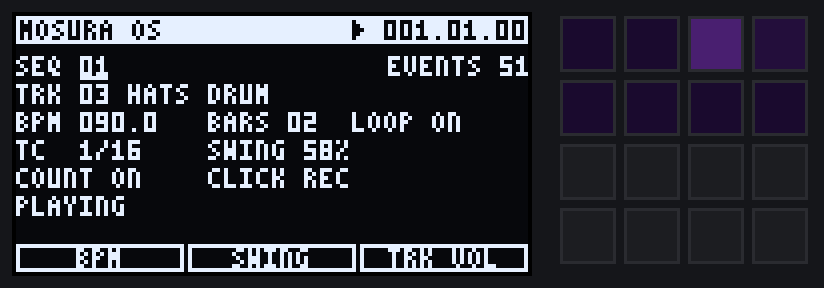
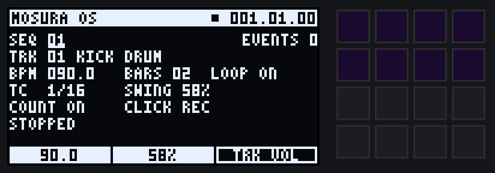
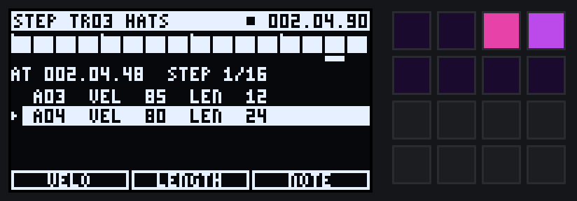
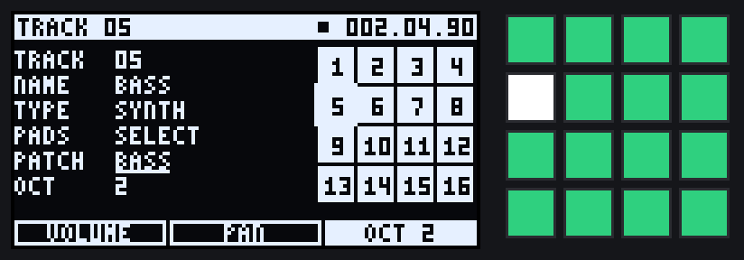
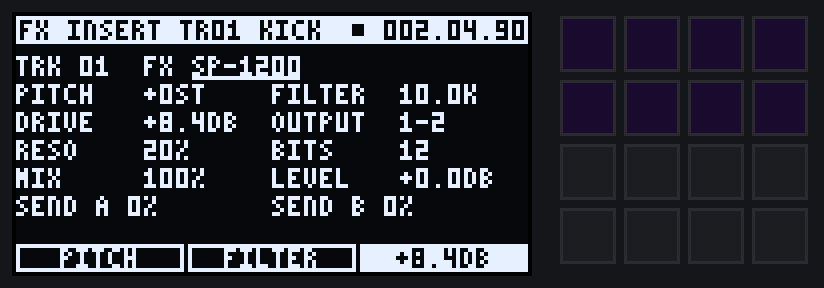
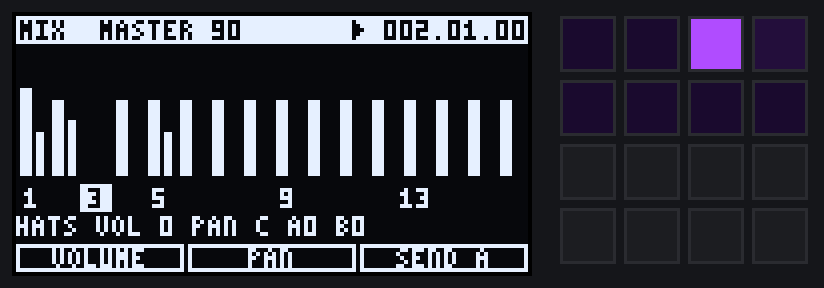
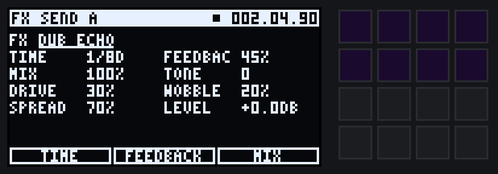

# MOSURA OS

An MPC 2000XL / 2500 style operating system for the Roland SP-404MK2.

DOOM OS proved the SP can run a custom OS, and it added a lot: a piano roll,
effect automation, more sequencing. But it adds them on top of what the SP
already struggles with, which is menu diving and button combos. MOSURA OS
goes the other way. It takes the workflow the MPC 2000XL and 2500 got right
and rebuilds the SP around it:

* **One button, one screen.** Six screens, each on its own button. Pressing
  the button again flips that screen's pages. There are no two-button combos
  for anything you do every session.
* **The same three zones on every screen.** A header with where you are and
  the transport, fields in the middle, and a knob row at the bottom that
  always says what CTRL 1, 2 and 3 do right now.
* **Sequences and tracks, like an MPC.** Thirty-two sequences, sixteen
  tracks, 96 PPQN, timing correct with swing, REC and OVERDUB, count-in,
  note repeat, a step editor, song mode, next-sequence queueing and undo.
* **Effects belong to tracks and buses.** An effect is not tied to a button
  or to whatever pad you last touched. Each track has an insert, two send
  buses feed two send effects, and the master has two slots. All of it is
  on one FX screen.

Like the rest of this repository, MOSURA OS is portable C with no allocation
and no I/O, ready to port when the SP can load code (see
[PORTING.md](PORTING.md)). Until then it runs on a desktop in the simulator,
`build/mosura`, which plays scripts of button presses and writes the audio
and screenshots.



## Screens

| Key | Screen | VALUE turn / push | CTRL 1 / 2 / 3 | Pressing the key again |
|---|---|---|---|---|
| MAIN | Sequence, track, tempo, bars, loop, timing correct, swing, count-in, click | pick / edit a field | BPM, Swing, track level | — |
| STEP | Step editor for the active track | move along the swung grid (SHIFT: a bar); push picks the next event at the step | Velocity, Length, Note of the selected event | — |
| TRACK | Track name, type, patch, octave, play mode; 4×4 track grid | pick / edit a field | Level, Pan, Send A (drum) or Octave (synth) | cycles what pads do: MUTE → SOLO → SELECT |
| FX | Effect and its parameters for one slot | pick / edit a field | the effect's first three parameters | pages: INSERT → SEND A → SEND B → MASTER 1 → MASTER 2 |
| MIX | 16 channel strips with level and meter | pick the track; push mutes it | Level, Pan, Send A (page 2: Send B, Master) | page 1 ↔ page 2 |
| SONG | List of sequences and repeats | pick a step; push on END adds one | Seq, Repeats, Loop song | — |

EXIT leaves a field you are editing, or goes back to MAIN.

| MAIN | STEP |
|---|---|
|  |  |
| **TRACK** | **FX** |
|  |  |
| **MIX** | **FX: SEND A** |
|  |  |

## Sequencing, the MPC way

**Sequences** hold the music: up to 2048 events each, any length from 1 to
99 bars, with their own tempo. **Tracks** are the 16 channels the events
play on. Unlike on the MPC, tracks are shared by all sequences, so a track's
name, type, level and effects stay put when you change sequence.

A track is either:

* **DRUM**: pads play samples from the current bank (A to J, 16 pads each).
  ONESHOT plays the whole sample. GATE plays only while the pad (or the
  recorded note) is held, which is what chops want.
* **SYNTH**: pads play the Juno-106 engine chromatically from the C of the
  track's octave, with the patch you pick on the TRACK screen.

### Recording

1. Choose the track on MAIN (`TRK` field), or press TRACK until the pads
   say SELECT and hit the track's pad.
2. Press **REC** (replace) or **OVERDUB** (add). The key blinks: armed.
3. Press **PLAY**. With COUNT on you get one bar of count-in first.
4. Play. Hits are moved onto the timing correct grid (`TC`) with swing, as
   on the MPC. Note lengths are how long you hold the pad.
5. Press the lit record key to punch out, or PLAY to stop.

REC replaces the active track's events as the playhead passes them, for one
pass. Then it carries on as OVERDUB, like the MPC 2000XL.

* **Note repeat:** hold NOTE REPEAT and pads. The pads repeat at the TC rate
  on the swung grid, with the velocity you hit them at.
* **Erase:** while playing, hold ERASE and a pad to wipe that pad's events
  from the active track as the playhead passes.
* **Undo:** UNDO restores the sequence from before the last recording or
  edit. Press it again to redo.
* **Full level:** FULL LEVEL makes every hit velocity 127.
* **Tap tempo:** TAP.
* **Next sequence:** turn the SEQ field while playing and the new sequence is
  queued. It takes over at the end of the current one.

### Step editing

The STEP screen shows the active track's current bar as 16 cells, with the
events at the cursor listed underneath. VALUE moves the cursor along the
same swung grid recording snaps to, so a swung note you played in shows up
on its step. Hit a pad to add an event at the cursor. CTRL 1-3 change the
selected event's velocity, length and note, and ERASE deletes it. SHIFT +
PLAY plays from the cursor.

### Song mode

On the SONG screen, push VALUE on END to add a step. CTRL 1 picks the
sequence and CTRL 2 the number of repeats. PLAY on the SONG screen plays the
song; PLAY anywhere else plays the current sequence.

## Effects

```
 track 1..16 ──▶ [ INSERT ] ──▶ level / pan ──┬─────────────────────────────▶ master ──▶ [ MASTER 1 ] ──▶ [ MASTER 2 ] ──▶ out
                                              ├─ send A ──▶ [ SEND A ] ──────▶ master
                                              └─ send B ──▶ [ SEND B ] ──────▶ master
```

To put an effect somewhere, press **FX** until the header says where
(INSERT for the active track, SEND A, SEND B, MASTER 1, MASTER 2), push
VALUE, turn to pick the effect and push again. CTRL 1-3 are now its first
three parameters, and every parameter is listed on the screen to edit with
VALUE. A track's send levels are at the bottom of its INSERT page, and on
CTRL 3 in MIX.

* Effects are part of the project, not of a button. A recorded sequence
  always plays through the same effects, and changing screens never changes
  what the knobs are routed to without the screen saying so.
* Sends are post-fader. An effect loaded on a send bus comes up 100% wet.
* There are 8 insert slots shared by the 16 tracks, plus the 2 sends and
  2 masters. The 9th insert says so instead of failing silently.
* Tempo-synced effects (Stutter, Dub Echo) follow the sequence's tempo and
  position.

All of the doomfx effects can go in any slot: SP-1200, MPC60, MPC3000, Bit
Ladder, Bus Glue, Juno Chorus, plus four new ones:

| Effect | CTRL 1 / 2 / 3 | More | What it is |
|---|---|---|---|
| **Tape Warp** | Wow, Flutter, Sat | Age, Bump, Hiss, Mix, Level | A worn cassette / 4-track. Wow drifts at random, so it never loops, and the pitch really bends. Head bump at 90 Hz, HF loss and hiss with Age |
| **Dust** | Crackle, Wear, Noise | Rumble, Mono, Mix, Level | A worn record. Crackle with realistic size spread and rare pops, groove wear (band narrowing, mid grit), surface noise, platter rumble, mono lows |
| **Stutter** | Rate, Gate, Mode | Swing, Decay, Fall, Mix, Level | Tempo-locked chop. Gate chops the live signal on an MPC-swung grid. Repeat records one slice and loops it, each repeat falling in pitch and fading. Turn CTRL 3 to Repeat and back for throws |
| **Dub Echo** | Time, Feedback, Mix | Tone, Drive, Wobble, Spread, Level | Tempo-synced tape echo. Changing Time glides like a moving tape head (siren sweeps), and feedback past 100% runs away into a saturated wash that stays bounded |

## Suggested mapping onto the SP-404MK2

MOSURA OS works with logical keys (`include/mos.h`), so the physical
layout is one table in the port. Here is the intended mapping. It has not
been checked against hardware, because there is no way to load code yet:

| MOSURA key | SP-404MK2 control | Why |
|---|---|---|
| MAIN, STEP, TRACK, FX, MIX, SONG | the six effect buttons: FILTER+DRIVE, RESONATOR, DELAY, ISOLATOR, DJFX LOOPER, MFX | effects no longer need dedicated buttons, so these become the screen keys, in a row like the MPC's mode keys |
| CTRL 1-3 | CTRL 1-3 | always the knob row |
| VALUE turn / push | VALUE | same as now |
| EXIT | EXIT | same as now |
| REC / OVERDUB / PLAY | REC / TR-REC / the pattern start-stop button | |
| NOTE REPEAT | ROLL | the SP's roll is already a note repeat |
| FULL LEVEL | HOLD | a latch, like HOLD |
| ERASE | DEL | |
| UNDO | REMAIN | a free button, so undo is one press |
| TAP | BPM / TAP | |
| BANK A-E (twice for F-J) | bank buttons | same as now |
| SHIFT | SHIFT | only for accelerators that are also on screen (SHIFT + VALUE moves a bar, SHIFT + PLAY plays from the step cursor) |

The pads' RGB LEDs show state through `mos_pad_color()`. On the TRACK screen
they are the 16 tracks (green playing, dim red muted, amber solo, white
active). On STEP they light the pads that have an event at the cursor.
Elsewhere they show loaded pads and hits.

## Making it yours

Everything that gives the OS its personality is in
[`src/os/theme.h`](../src/os/theme.h): the name and tagline on the boot
screen, the track names you pick from, the default track names, the pad LED
palette and the simulator's screen colours. The font is in
[`src/os/gfx.c`](../src/os/gfx.c) (3×5 glyphs with square digits, in the
spirit of the MPC LCD).

## The simulator

```sh
make
./build/mosura run examples/first-beat.mos --out beat.wav
```

`examples/first-beat.mos` builds a whole beat with button presses: a kick
recorded with count-in, an overdubbed snare with a ghost note, hats with
note repeat, open hats in the step editor, a Juno bassline on a synth
track, then SP-1200 on the kick, Dub Echo on send A for the snare, Bus Glue
and Tape Warp on the master, and a Stutter throw on the hats. It writes the
screenshots in this document. Script commands:

| Command | Does |
|---|---|
| `kit` | synthesised drums on A01-A08: kick, snare, hat, open hat, clap, rim, tom, shaker |
| `load A01 file.wav` | a WAV on a sample pad (A01 to J16) |
| `key NAME`, `down NAME`, `up NAME` | press, hold or release a key (`mosura keys` lists them) |
| `push`, `turn N` | VALUE push, VALUE turn by N detents |
| `knob 1..3 POS` | a CTRL knob to POS (0 to 1) |
| `pad N [VEL] [HOLD]`, `padon N VEL`, `padoff N` | hit, hold or release pad N (1 to 16) |
| `wait 500ms` / `2s` / `1bar` / `2beats` / `24t` | let time pass |
| `at BAR.BEAT.TICK` | run until the playhead gets there |
| `screen [FILE.png]` | print the screen, or save the screen and pad LEDs as a PNG |
| `events` | list the sequence's events |

## Not done yet

* Saving and loading projects (the state is plain data, so it's mostly a
  file format and a LOAD/SAVE page).
* Sample editing: trim, chop, per-pad tune, choke groups. Recording and
  resampling.
* MIDI in and out, and MIDI tracks.
* MPC "16 levels", sequence copy / insert bars, track name editing letter by
  letter (names come from a list for now).
* A fixed-point port of the hot paths, if the SP's DSP budget needs it.
